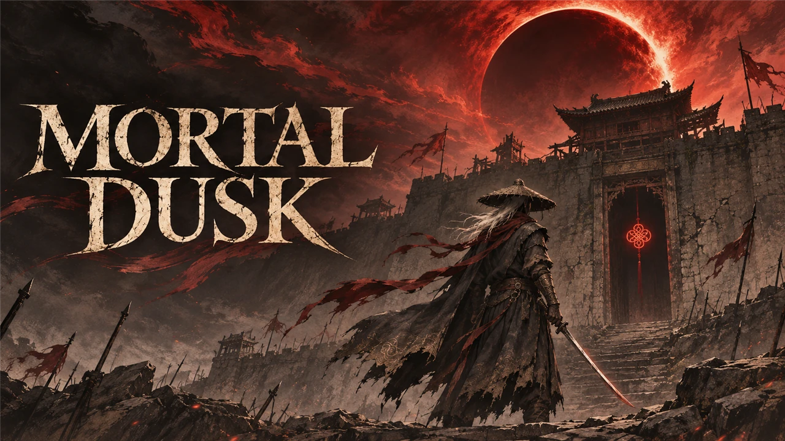

# Mortal Dusk

One death is all it takes: on 66 Days a single death ends the run. 66 Days is open from the first game.

## What it does

The 66 Days difficulty, with one life:

- On 66 Days a single death ends the run. The game's own end of the run follows, the same as when the 66 days are
  used up; the run then starts again from its beginning.
- The days left show 1 while you are alive. Story events that take a day do not count: only a death does.
- 66 Days is open from your first game: no need to beat the game first. Without the mod it locks again (nothing
  is saved).
- The menus say so: in the difficulty menu the difficulty is called "MORTAL DUSK" with its own description, its
  dialogs say "Mortal Dusk", and the main menu's "CONTINUE" reads "ONE DEATH IS ALL IT TAKES" (English texts; other
  languages keep the game's texts).
- The other difficulties stay as they are.

It is a UE4SS script; it changes no game file.

## Screenshots

## How to install

1. Install UE4SS for Phantom Blade Zero, for example [UE4SS](https://github.com/KintaroModding/ue4ss) (its zip
   `phantombladezero_ue4ss_<version>.zip`: the official UE4SS build with a config that makes it run in this game).
2. Download the zip of the latest release on GitHub (`phantombladezero_mortaldusk_<version>.zip`).
3. Unpack it into the game folder `platform\steam\`, next to the game's exe. It adds the folder
   `ue4ss\Mods\phantombladezero_mortaldusk\` (with the file `enabled.txt`, UE4SS starts it by itself).
4. Start the game.

To check that it runs: `platform\steam\ue4ss\UE4SS.log` has the line `[Mortal Dusk] <version> loaded.`

To update the mod, replace the folder with the one of the new release; to keep your settings, put your old
`Scripts\config.lua` back (a setting that it does not have keeps its default). To remove it, delete the folder
`ue4ss\Mods\phantombladezero_mortaldusk\`. The game saves the days left: a run that you played with the mod keeps 1
day after you remove it.

## How to use

Start a new game and choose "MORTAL DUSK". Then do not die.

## Settings

The settings are in `platform\steam\ue4ss\Mods\phantombladezero_mortaldusk\Scripts\config.lua`. Open it with a text editor, change
a value and save: the mod reads the file every 5 seconds, so the game uses it without a restart. `UE4SS.log` shows
the settings in use in the line
`[Mortal Dusk] Settings: ...`, and names each value it could not use.

| Setting | Default | What it does |
|---|---|---|
| `LogDusk` | `false` | `true`: `UE4SS.log` names the days left, each death and each text change (for tests and bug reports) |

## Compatibility

- Game version: Steam build 26367565 (`CL-302256_JKS-17280`).
- Tested with UE4SS `v4.0.0`.
- Made to work with [Let's Die Again!](https://github.com/KintaroModding/phantombladezero_letsdieagain) (its
  "CONTINUE" text then stays) and with
  [66 Days Unlocked](https://github.com/KintaroModding/phantombladezero_66daysunlocked) (not needed with this mod);
  neither pair is tested together yet.

## Known issues

- The save lists and the settings still call the difficulty "66 DAYS"; the new name shows in the difficulty menu,
  its dialogs and the main menu.

## How to build

There is nothing to build: `src\phantombladezero_mortaldusk\Scripts\main.lua` is the mod. `tests\test_main.py` runs the script
outside the game with Lua 5.4 ([lupa](https://pypi.org/project/lupa/)) and mocks of UE4SS:
`python tests\test_main.py`. `README.md` has the details.

## Credits

Made by Kintaro. MIT license: you may use, change and share this mod. UE4SS is made by the
[UE4SS-RE team](https://github.com/UE4SS-RE/RE-UE4SS). Phantom Blade Zero belongs to its makers.
